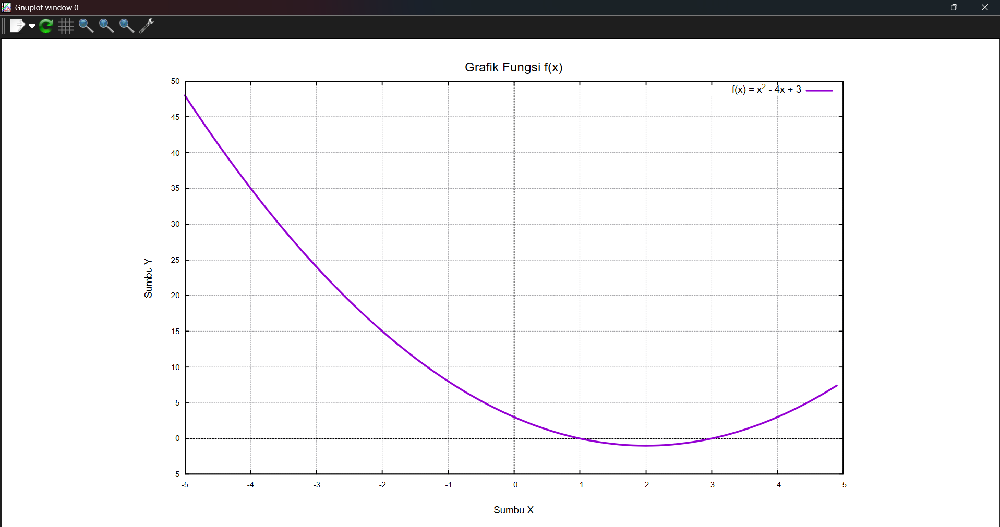
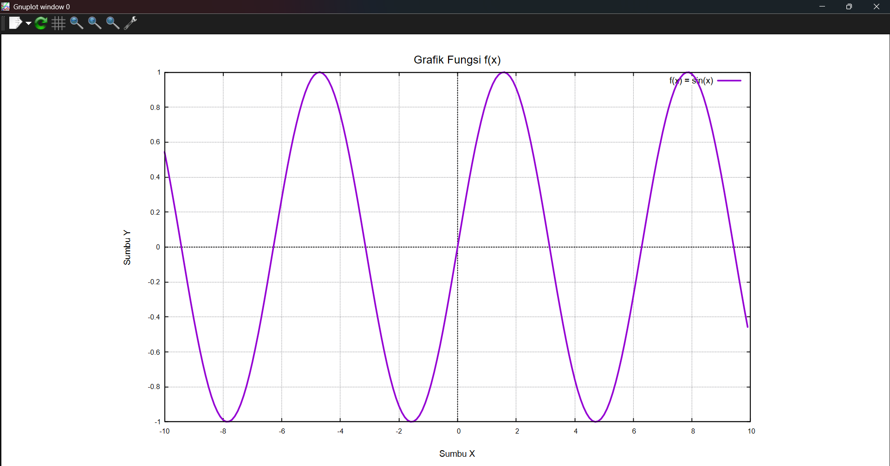
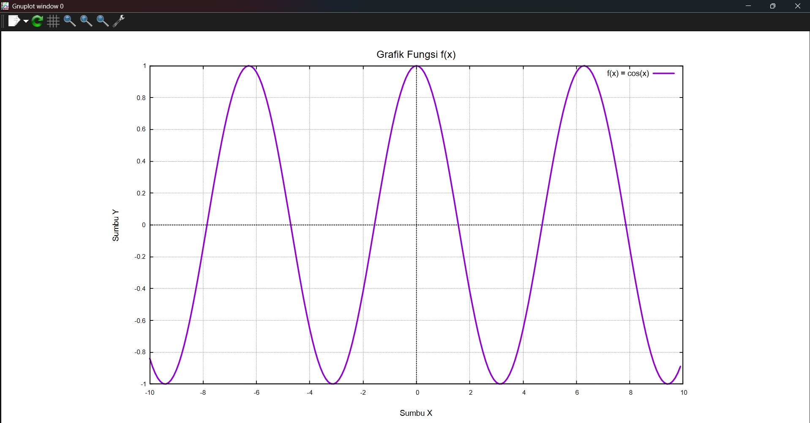
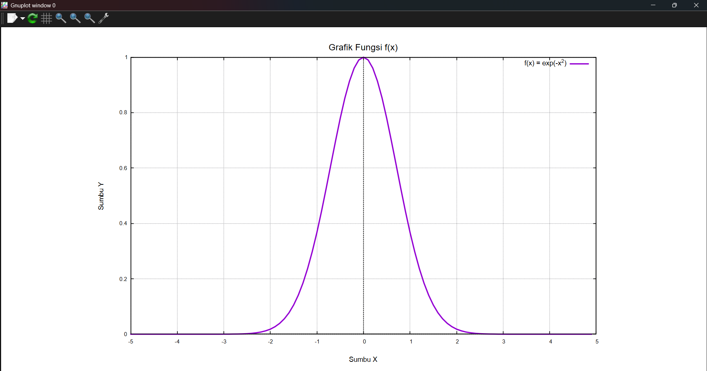
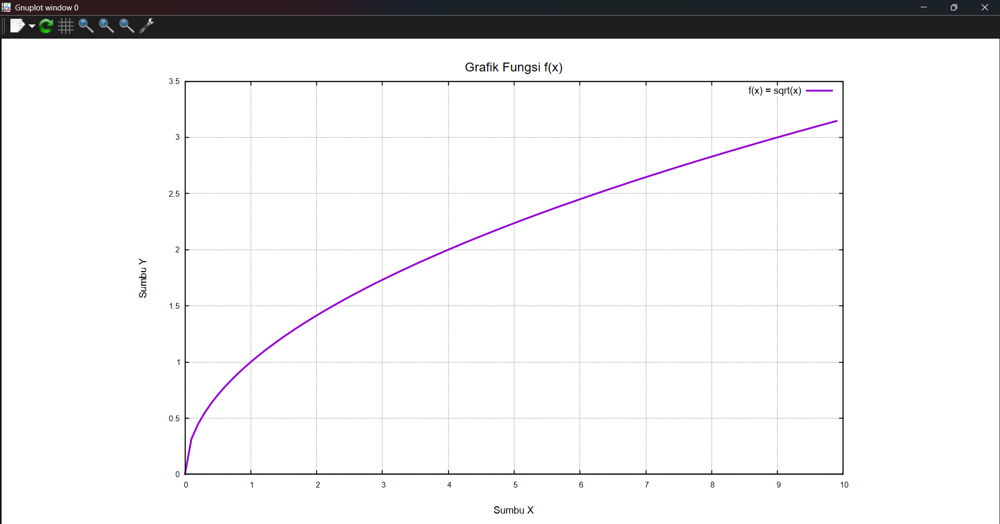
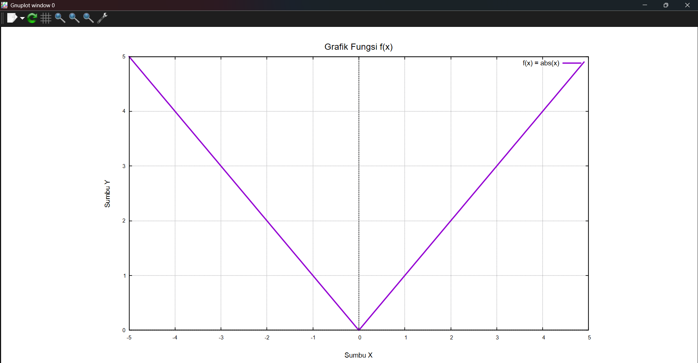
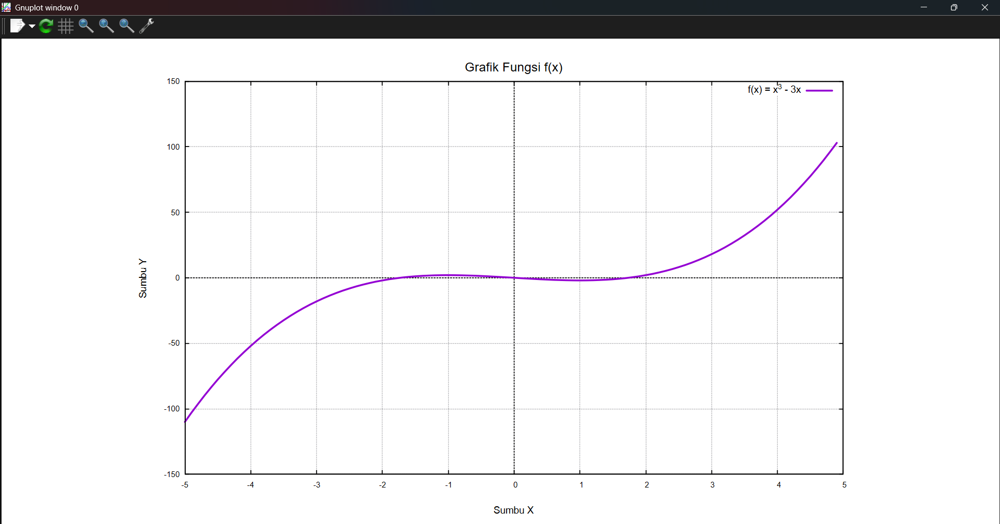
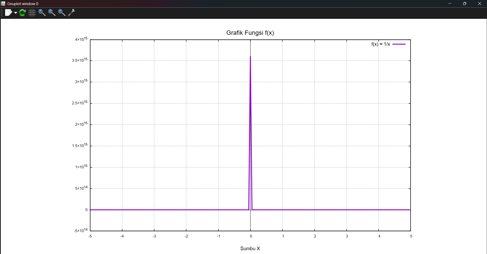

 
# UTS Kalkulus 2 — Visualisasi Grafik Fungsi Satu Variabel Menggunakan C++

Program ini merupakan implementasi tugas **Ujian Tengah Semester (UTS) mata kuliah Kalkulus 2** untuk menghitung dan memvisualisasikan grafik fungsi matematika dengan satu variabel bebas menggunakan bahasa pemrograman **C++**.

Program memungkinkan pengguna memasukkan fungsi matematika secara langsung, menentukan batas bawah dan batas atas nilai \(x\), serta menentukan interval atau kepadatan titik perhitungan. Hasil perhitungan kemudian disimpan dalam file data dan divisualisasikan menjadi grafik dua dimensi menggunakan Gnuplot.

> **PENTING — Ketentuan Tugas**
>
> Implementasi UTS ini wajib menggunakan bahasa pemrograman **C++**. Program utama, proses perhitungan, pengolahan data, dan pembentukan titik grafik dibuat menggunakan C++.
>
> Penggunaan Python sebagai bahasa utama, termasuk penggunaan library visualisasi seperti Matplotlib, tidak digunakan dalam pengerjaan tugas ini. Visualisasi dilakukan menggunakan Gnuplot sebagai aplikasi plotting eksternal yang menerima data hasil perhitungan program C++.

---

## Daftar Isi

- [1. Deskripsi Proyek](#1-deskripsi-proyek)
- [2. Tujuan Pembuatan](#2-tujuan-pembuatan)
- [3. Gambaran Cara Kerja](#3-gambaran-cara-kerja)
- [4. Teknologi dan Tools](#4-teknologi-dan-tools)
- [5. Persyaratan Sistem](#5-persyaratan-sistem)
- [6. Instalasi dan Persiapan](#6-instalasi-dan-persiapan)
- [7. Struktur Folder](#7-struktur-folder)
- [8. Cara Menjalankan Program](#8-cara-menjalankan-program)
- [9. Contoh Penggunaan](#9-contoh-penggunaan)
- [10. Penjelasan Source Code](#10-penjelasan-source-code)
- [11. Format Fungsi Matematika](#11-format-fungsi-matematika)
- [12. Hasil Pengujian dan Screenshot](#12-hasil-pengujian-dan-screenshot)
- [13. Penanganan Kesalahan](#13-penanganan-kesalahan)
- [14. Batasan Program](#14-batasan-program)
- [15. Pengembang](#15-pengembang)

---

## 1. Deskripsi Proyek

Pada UTS mata kuliah Kalkulus 2, tugas yang dikerjakan adalah membuat program untuk menggambarkan grafik suatu fungsi matematika dengan satu variabel bebas.

Program dibuat menggunakan C++ dan menerima tiga parameter utama dari pengguna:

1. **Fungsi matematika**: rumus yang ingin divisualisasikan, misalnya `x^2 - 4x + 3`.
2. **Batas nilai X**: menentukan batas bawah (`x1`) dan batas atas (`x2`).
3. **Kepadatan titik (D)**: menentukan jarak antar-titik yang digunakan dalam proses perhitungan.

Berdasarkan input tersebut, program menghitung nilai fungsi secara berulang, menyimpan pasangan koordinat `(x, y)`, kemudian menampilkan grafik dua dimensi.

Program dirancang agar tidak hanya dapat menghitung satu fungsi tertentu, tetapi juga dapat digunakan untuk berbagai macam fungsi matematika yang dimasukkan oleh pengguna.

## 2. Tujuan Pembuatan

Tujuan dari proyek ini adalah:

- Mengimplementasikan konsep fungsi matematika menggunakan bahasa C++.
- Memahami proses perhitungan nilai fungsi berdasarkan variabel bebas.
- Menggunakan perulangan untuk menghasilkan sejumlah titik koordinat.
- Menggunakan array dinamis atau `std::vector` untuk menyimpan hasil perhitungan.
- Mengolah data koordinat menjadi file yang dapat dibaca aplikasi plotting.
- Memvisualisasikan fungsi matematika dalam bentuk grafik dua dimensi.
- Memahami hubungan antara nilai input, interval, dan bentuk grafik fungsi.

## 3. Gambaran Cara Kerja

Secara umum, program bekerja melalui beberapa tahapan berikut.

```text
+---------------------------+
|       Mulai Program       |
+---------------------------+
             |
             v
+---------------------------+
| Input Fungsi Matematika   |
+---------------------------+
             |
             v
+---------------------------+
| Input Batas X1 dan X2     |
+---------------------------+
             |
             v
+---------------------------+
| Input Kepadatan Titik (D) |
+---------------------------+
             |
             v
+---------------------------+
| Validasi Input Pengguna   |
+---------------------------+
             |
             v
+---------------------------+
| Menghitung Nilai X        |
| x(i) = x1 + (i * D)       |
+---------------------------+
             |
             v
+---------------------------+
| Menghitung Nilai Y        |
| y(i) = f(x(i))            |
+---------------------------+
             |
             v
+---------------------------+
| Menyimpan Titik Koordinat |
| Menggunakan std::vector   |
+---------------------------+
             |
             v
+---------------------------+
| Menyimpan Data ke File    |
| points.dat                |
+---------------------------+
             |
             v
+---------------------------+
| Visualisasi Menggunakan   |
| Gnuplot                   |
+---------------------------+
             |
             v
+---------------------------+
|       Grafik 2D Tampil    |
+---------------------------+
             |
             v
+---------------------------+
|       Selesai             |
+---------------------------+
```

### Rumus Perhitungan

Program menggunakan pendekatan perhitungan titik secara berulang.

Rumus untuk menentukan nilai X:

\[
x_i = x_1 + (i \times D)
\]

Rumus untuk menentukan nilai Y:

\[
y_i = f(x_i)
\]

Keterangan:

| Simbol | Keterangan |
|---|---|
| \(x_i\) | Nilai X pada iterasi ke-i |
| \(x_1\) | Batas bawah interval |
| \(D\) | Jarak atau interval antar-titik |
| \(i\) | Indeks iterasi |
| \(f(x_i)\) | Nilai fungsi pada X tertentu |
| \(y_i\) | Hasil perhitungan fungsi |

Sebagai contoh, jika pengguna memasukkan:

- Fungsi: `x^2`
- Batas bawah: `-2`
- Batas atas: `2`
- Interval: `1`

Maka titik yang dihitung adalah:

| X | Y = X² |
|---:|---:|
| -2 | 4 |
| -1 | 1 |
| 0 | 0 |
| 1 | 1 |
| 2 | 4 |

Titik-titik tersebut kemudian digunakan untuk membentuk grafik fungsi.

## 4. Teknologi dan Tools

Berikut teknologi dan perangkat lunak yang digunakan dalam pengerjaan proyek.

| Teknologi | Kegunaan |
|---|---|
| C++ | Bahasa pemrograman utama |
| GCC / MinGW-w64 | Compiler C++ |
| ExprTk | Membaca dan mengevaluasi ekspresi matematika |
| Gnuplot | Membuat visualisasi grafik dua dimensi |
| Git | Version control |
| GitHub | Penyimpanan repository proyek |
| Visual Studio Code | Editor kode (opsional) |

### ExprTk

ExprTk merupakan library berbasis C++ yang digunakan untuk membaca dan mengevaluasi ekspresi matematika.

Library ini memungkinkan pengguna memasukkan rumus secara dinamis tanpa harus membuat fungsi C++ baru untuk setiap rumus.

Contohnya:

```cpp
sin(x) + x^2
```

Program akan memproses ekspresi tersebut dan menghitung nilai fungsi berdasarkan nilai `x` yang diberikan.

ExprTk digunakan sebagai header-only library, sehingga tidak membutuhkan proses instalasi library terpisah seperti library yang harus di-link secara manual.

### Gnuplot

Gnuplot digunakan untuk mengubah data koordinat hasil perhitungan C++ menjadi grafik.

Program C++ menyimpan data dalam format teks, kemudian membuat script Gnuplot untuk membaca data dan menampilkannya sebagai grafik.

## 5. Persyaratan Sistem

Sebelum menjalankan program, pastikan perangkat sudah memiliki:

- Sistem operasi Windows.
- Compiler C++ yang mendukung C++17.
- Gnuplot.
- Git untuk melakukan cloning repository.
- Terminal PowerShell atau terminal lainnya.

Proyek ini dikembangkan dan diuji menggunakan:

| Komponen | Versi |
|---|---|
| Compiler | MinGW-w64 GCC 14.2.0 |
| Standar C++ | C++17 |
| Gnuplot | 6.0 patchlevel 4 |
| ExprTk | Header-only (`exprtk.hpp`) |

Versi lain yang kompatibel juga dapat digunakan.

## 6. Instalasi dan Persiapan

Bagian ini menjelaskan langkah-langkah untuk menyiapkan lingkungan pengembangan, khususnya bagi pengguna yang baru melakukan cloning repository.

### 6.1. Menginstal Compiler C++

Program membutuhkan compiler C++ untuk mengubah source code menjadi executable.

Salah satu pilihan compiler yang dapat digunakan adalah MinGW-w64.

Pastikan compiler sudah terpasang dan direktori `bin` compiler sudah ditambahkan ke Environment Variable `PATH`.

Untuk memeriksa instalasi, jalankan PowerShell:

```powershell
g++ --version
```

Jika berhasil, terminal akan menampilkan informasi versi GCC.

Contoh:

```text
g++.exe (MinGW-W64 x86_64-ucrt-posix-seh)
14.2.0
```

### 6.2. Menginstal Gnuplot

Gnuplot digunakan untuk menampilkan hasil visualisasi grafik.

Unduh installer melalui halaman resmi:

https://sourceforge.net/projects/gnuplot/

Setelah proses instalasi selesai, pastikan Gnuplot dapat dijalankan.

Lokasi instalasi yang digunakan dalam pengembangan proyek ini:

```text
C:\Program Files\gnuplot\bin\gnuplot.exe
```

Periksa instalasi melalui PowerShell:

```powershell
& "C:\Program Files\gnuplot\bin\gnuplot.exe" --version
```

Jika berhasil, informasi versi Gnuplot akan ditampilkan.

> **Catatan:** Source code proyek saat ini menggunakan lokasi executable Gnuplot tersebut secara langsung. Jika Gnuplot terpasang di lokasi berbeda, sesuaikan variabel `gnuplotPath` pada `UTS/src/plotter.cpp`.

### 6.3. Menginstal Git

Git digunakan untuk mengambil source code dari GitHub.

Periksa apakah Git sudah tersedia:

```powershell
git --version
```

Jika belum terpasang, unduh melalui:

https://git-scm.com/downloads

### 6.4. Menggunakan ExprTk

File ExprTk sudah disertakan di dalam repository:

```text
UTS/third_party/exprtk.hpp
```

Dengan demikian, pengguna yang melakukan cloning tidak perlu mengunduh ulang file tersebut.

ExprTk digunakan melalui direktif:

```cpp
#include <exprtk.hpp>
```

Pastikan file header tetap berada di dalam folder `third_party` agar proses kompilasi dapat menemukan library tersebut.

## 7. Struktur Folder

Berikut struktur direktori untuk bagian UTS:

```text
UTS/
│
├── data/
│   └── points.dat
│
├── include/
│   ├── function.hpp
│   └── plotter.hpp
│
├── output/
│   ├── uts.exe
│   └── plot.gp
│
├── screenshots/
│   ├── 01-fungsi-kuadrat.png
│   ├── 02-fungsi-sinus.png
│   ├── 03-fungsi-cosinus.png
│   ├── 04-fungsi-eksponensial.png
│   ├── 05-fungsi-akar.png
│   ├── 06-fungsi-mutlak.png
│   ├── 07-fungsi-kubik.png
│   └── 08-fungsi-rasional.png
│
├── src/
│   ├── function.cpp
│   ├── main.cpp
│   └── plotter.cpp
│
├── third_party/
│   └── exprtk.hpp
│
└── README.md
```

### Penjelasan Folder dan File

| Folder/File | Fungsi |
|---|---|
| `data/` | Menyimpan hasil perhitungan titik koordinat |
| `include/` | Menyimpan file header C++ |
| `output/` | Menyimpan file executable dan script Gnuplot |
| `screenshots/` | Menyimpan dokumentasi hasil pengujian |
| `src/` | Menyimpan implementasi source code |
| `third_party/` | Menyimpan library eksternal ExprTk |
| `main.cpp` | Program utama dan interaksi dengan pengguna |
| `function.cpp` | Implementasi evaluasi fungsi matematika |
| `plotter.cpp` | Perhitungan titik, penyimpanan data, dan visualisasi |
| `function.hpp` | Deklarasi kelas fungsi matematika |
| `plotter.hpp` | Deklarasi struktur titik dan kelas Plotter |

## 8. Cara Menjalankan Program

### 8.1. Clone Repository

Buka PowerShell, kemudian jalankan:

```powershell
git clone https://github.com/illhammf/kalkulus2-grafik.git
```

Masuk ke direktori repository:

```powershell
cd kalkulus2-grafik
```

Masuk ke folder UTS:

```powershell
cd UTS
```

Pastikan seluruh folder dan file tersedia.

### 8.2. Kompilasi Program

Sebelum menjalankan program, source code harus dikompilasi terlebih dahulu.

Jalankan perintah berikut dari direktori utama repository (`kalkulus2-grafik`):

```powershell
g++ -std=c++17 -O0 -g0 "-Wa,-mbig-obj" -I UTS/include -I UTS/third_party UTS/src/main.cpp UTS/src/function.cpp UTS/src/plotter.cpp -o UTS/output/uts.exe
```

Penjelasan parameter:

| Parameter | Kegunaan |
|---|---|
| `-std=c++17` | Menggunakan standar C++17 |
| `-O0` | Menonaktifkan optimasi compiler |
| `-g0` | Tidak menyertakan informasi debug |
| `-Wa,-mbig-obj` | Mengizinkan format object file dengan jumlah section yang besar pada lingkungan MinGW tertentu |
| `-I UTS/include` | Menentukan lokasi file header proyek |
| `-I UTS/third_party` | Menentukan lokasi header ExprTk |
| `-o UTS/output/uts.exe` | Menentukan lokasi executable hasil kompilasi |

Jika proses kompilasi berhasil, file berikut akan terbentuk:

```text
UTS/output/uts.exe
```

### 8.3. Menjalankan Program

Jalankan program dari direktori utama repository:

```powershell
.\UTS\output\uts.exe
```

Program akan meminta pengguna memasukkan fungsi matematika, batas bawah, batas atas, dan interval titik.

> **Penting:** Jalankan executable dari direktori utama repository agar lokasi relatif folder `UTS/data` dan `UTS/output` dapat ditemukan dengan benar.

## 9. Contoh Penggunaan

Berikut contoh penggunaan program untuk menggambarkan fungsi:

\[
f(x) = \sin(x) + x^2
\]

Input yang diberikan:

```text
Masukkan fungsi matematika : sin(x) + x^2
Masukkan batas bawah X1    : -5
Masukkan batas atas X2     : 5
Masukkan kepadatan titik D : 0.1
```

Program akan melakukan perhitungan menggunakan rumus:

\[
x_i = -5 + (i \times 0.1)
\]

Kemudian setiap nilai X dimasukkan ke dalam fungsi:

\[
y_i = \sin(x_i) + x_i^2
\]

Hasil perhitungan disimpan sebagai pasangan koordinat X dan Y.

Contoh format file data:

```text
X          Y
-5.000000  25.958924
-4.900000  24.311541
-4.800000  22.836165
...
```

Data tersebut kemudian digunakan oleh Gnuplot untuk membuat grafik.

## 10. Penjelasan Source Code

Source code dibagi menjadi beberapa bagian agar setiap proses memiliki tanggung jawab masing-masing.

### 10.1. `main.cpp` — Program Utama

File ini merupakan titik awal eksekusi program.

Tanggung jawab utamanya:

- Meminta input fungsi dari pengguna.
- Meminta batas bawah dan batas atas X.
- Meminta nilai interval atau kepadatan titik.
- Memvalidasi input numerik.
- Menampilkan informasi metode perhitungan.
- Memanggil proses pembentukan titik.
- Menampilkan hasil perhitungan.
- Menyimpan data dan menjalankan visualisasi.

Dengan pemisahan ini, `main.cpp` berperan sebagai pengatur alur program.

### 10.2. `function.hpp` dan `function.cpp` — Evaluasi Fungsi

Bagian ini menangani proses membaca dan menghitung fungsi matematika.

Di dalamnya terdapat kelas:

```cpp
MathematicalFunction
```

Kelas tersebut menggunakan beberapa komponen ExprTk:

- `symbol_table`: menyimpan variabel matematika, seperti `x`.
- `expression`: menyimpan ekspresi yang akan dihitung.
- `parser`: memproses rumus yang dimasukkan pengguna.

Contoh registrasi variabel:

```cpp
symbolTable.add_variable("x", x);
symbolTable.add_constants();
```

Kode tersebut membuat variabel `x` dapat digunakan dalam rumus matematika dan menambahkan konstanta bawaan ExprTk.

Fungsi `setFormula()` digunakan untuk memeriksa dan memproses rumus.

Sementara itu, `evaluate()` digunakan untuk menghitung nilai fungsi berdasarkan nilai X yang diberikan.

### 10.3. `plotter.hpp` dan `plotter.cpp` — Pengolahan dan Visualisasi

Bagian ini menangani pembentukan titik koordinat dan proses plotting.

Terdapat struktur:

```cpp
struct Point {
    double x;
    double y;
};
```

Struktur tersebut digunakan untuk menyimpan satu pasangan koordinat.

Program juga menggunakan:

```cpp
std::vector<Point>
```

`std::vector` digunakan sebagai array dinamis untuk menampung sejumlah titik hasil perhitungan.

Beberapa fungsi utama yang digunakan:

| Fungsi | Tanggung Jawab |
|---|---|
| `generatePoints()` | Menghasilkan titik koordinat berdasarkan fungsi dan interval |
| `saveData()` | Menyimpan titik koordinat ke file |
| `plotGraph()` | Membuat script dan menjalankan Gnuplot |

Setelah data disimpan, program membuat script `plot.gp` yang berisi pengaturan tampilan grafik.

Contoh perintah Gnuplot:

```gnuplot
plot 'UTS/data/points.dat' using 1:2 with lines
```

Perintah tersebut membaca kolom pertama sebagai sumbu X dan kolom kedua sebagai sumbu Y, kemudian menghubungkan titik-titik tersebut menjadi grafik.

## 11. Format Fungsi Matematika

Program mendukung berbagai ekspresi matematika yang dapat diproses oleh ExprTk.

Berikut beberapa contoh:

| Bentuk Matematika | Input Program |
|---|---|
| \(x^2\) | `x^2` |
| \(x^3 - 3x\) | `x^3 - 3x` |
| \(\sin(x)\) | `sin(x)` |
| \(\cos(x)\) | `cos(x)` |
| \(e^{-x^2}\) | `exp(-x^2)` |
| \(\sqrt{x}\) | `sqrt(x)` |
| \(|x|\) | `abs(x)` |
| \(\frac{1}{x}\) | `1/x` |
| \(\ln(x)\) | `log(x)` |

Beberapa fungsi matematika yang dapat dicoba:

- `sin(x)`
- `cos(x)`
- `tan(x)`
- `sqrt(x)`
- `abs(x)`
- `exp(x)`
- `log(x)`
- `log10(x)`

**Catatan:** Fungsi trigonometri menggunakan satuan radian. Selain itu, tidak semua nilai X selalu menghasilkan nilai Y yang valid. Contohnya, `sqrt(x)` tidak menghasilkan bilangan real untuk X negatif, sedangkan `1/x` tidak terdefinisi ketika X sama dengan nol.

## 12. Hasil Pengujian dan Screenshot

Pengujian dilakukan menggunakan beberapa jenis fungsi matematika untuk memastikan program dapat menghitung dan menampilkan berbagai bentuk grafik.

Berikut dokumentasi hasil pengujian.

### 12.1. Fungsi Kuadrat

Fungsi:

\[
f(x) = x^2 - 4x + 3
\]

```text
Fungsi : x^2 - 4x + 3
X1     : -5
X2     : 5
D      : 0.1
```

### 12.2. Fungsi Sinus

Fungsi:

\[
f(x) = \sin(x)
\]

```text
Fungsi : sin(x)
X1     : -10
X2     : 10
D      : 0.1
```

### 12.3. Fungsi Cosinus

Fungsi:

\[
f(x) = \cos(x)
\]

```text
Fungsi : cos(x)
X1     : -10
X2     : 10
D      : 0.1
```

### 12.4. Fungsi Eksponensial

Fungsi:

\[
f(x) = e^{-x^2}
\]

```text
Fungsi : exp(-x^2)
X1     : -5
X2     : 5
D      : 0.1
```

### 12.5. Fungsi Akar

Fungsi:

\[
f(x) = \sqrt{x}
\]

```text
Fungsi : sqrt(x)
X1     : 0
X2     : 10
D      : 0.1
```

### 12.6. Fungsi Nilai Mutlak

Fungsi:

\[
f(x) = |x|
\]

```text
Fungsi : abs(x)
X1     : -5
X2     : 5
D      : 0.1
```

### 12.7. Fungsi Kubik

Fungsi:

\[
f(x) = x^3 - 3x
\]

```text
Fungsi : x^3 - 3x
X1     : -5
X2     : 5
D      : 0.1
```

### 12.8. Fungsi Rasional

Fungsi:

\[
f(x) = \frac{1}{x}
\]

```text
Fungsi : 1/x
X1     : -5
X2     : 5
D      : 0.05
```

Fungsi ini digunakan untuk menguji perilaku program pada nilai yang tidak terdefinisi, yaitu ketika X sama dengan nol.

### Galeri Screenshot

Screenshot disimpan di dalam folder `UTS/screenshots/`.

<table>
  <tr>
    <td align="center" width="50%">
      <strong>01. Fungsi Kuadrat</strong><br>
      
    </td>
    <td align="center" width="50%">
      <strong>02. Fungsi Sinus</strong><br>
      
    </td>
  </tr>
  <tr>
    <td align="center" width="50%">
      <strong>03. Fungsi Cosinus</strong><br>
      
    </td>
    <td align="center" width="50%">
      <strong>04. Fungsi Eksponensial</strong><br>
      
    </td>
  </tr>
  <tr>
    <td align="center" width="50%">
      <strong>05. Fungsi Akar</strong><br>
      
    </td>
    <td align="center" width="50%">
      <strong>06. Fungsi Nilai Mutlak</strong><br>
      
    </td>
  </tr>
  <tr>
    <td align="center" width="50%">
      <strong>07. Fungsi Kubik</strong><br>
      
    </td>
    <td align="center" width="50%">
      <strong>08. Fungsi Rasional</strong><br>
      
    </td>
  </tr>
</table>

## 13. Penanganan Kesalahan

Program dilengkapi beberapa validasi untuk menghindari input yang tidak sesuai.

Beberapa kondisi yang ditangani:

| Kondisi | Penanganan |
|---|---|
| Rumus kosong | Program menampilkan pesan kesalahan |
| Rumus tidak valid | ExprTk menolak ekspresi yang tidak dapat diproses |
| Input angka tidak valid | Program meminta input numerik yang benar |
| Batas X sama | Perhitungan dihentikan karena interval tidak memiliki rentang |
| Batas X terbalik | Program menyesuaikan urutan batas secara otomatis |
| Interval nol atau negatif | Program menolak nilai interval |
| Interval tidak valid | Program menolak nilai yang bukan angka hingga |
| Nilai fungsi tidak valid | Titik dengan hasil non-finite tidak disimpan |
| Jumlah titik terlalu banyak | Program membatasi jumlah titik untuk menghindari penggunaan memori berlebihan |

## 14. Batasan Program

Meskipun program sudah mendukung berbagai fungsi matematika, terdapat beberapa batasan:

1. Program difokuskan pada fungsi dengan satu variabel bebas, yaitu X.
2. Visualisasi yang dihasilkan berupa grafik dua dimensi.
3. Fungsi matematika harus menggunakan sintaks yang dapat diproses oleh ExprTk.
4. Nilai X yang menghasilkan nilai Y tidak valid tidak dimasukkan ke dalam data hasil.
5. Program membutuhkan Gnuplot yang sudah terpasang untuk menampilkan grafik.
6. Lokasi executable Gnuplot perlu disesuaikan jika berbeda dari konfigurasi pengembangan.

## 15. Pengembang

**Nama:** Ilham Firmansyah

**Repository:**  
https://github.com/illhammf/kalkulus2-grafik

**Mata Kuliah:** Kalkulus 2

**Tugas:** Ujian Tengah Semester (UTS)

---

## Lisensi

Proyek ini dibuat untuk keperluan pembelajaran dan penyelesaian tugas akademik mata kuliah Kalkulus 2.

Source code proyek dapat dipelajari dan dikembangkan lebih lanjut dengan tetap memperhatikan lisensi library pihak ketiga yang digunakan, termasuk ExprTk.
